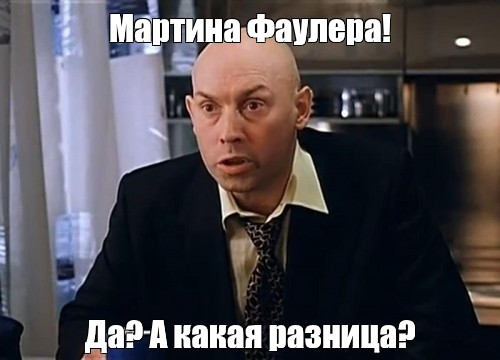

# Эволюция душноты: как закон коллективного разума превратился в триумф коллективной серости

Эволюционная биология учит нас простому правилу: объединение в группы необходимо для выживания и радикального усиления слабого признака - то есть компенсации того дефицита силы или навыков, которого отдельной особи критически не хватает для выживания в одиночку, в данном случае - превращения индивидуальной когнитивной или физической уязвимости в коллективную сверхспособность за счет эффекта массы, проще говоря, для масштабирования личной посредственности до размеров непреодолимой коллективной душноты.

Природа изящна в своей прагматичности. Физически стая волков способна завалить огромного медведя, перед которым каждый отдельный хищник - не более чем легкий завтрак. Плотная стая мелких птиц успешно отгоняет от гнезд хитрую лису. На просторах Хабра этот фундаментальный закон дикой природы претерпел поразительную, но логичную мутацию. Здесь, в экосистеме кармических войн и бесконечных ИТ-дискуссий, стая мышей с легкостью побеждает одинокого кота.

Каждый, кто хоть раз заглядывал в комментарии к сложным техническим или философским материалам, замечал их. Это неформальный орден Хранителей Душноты, Тайный Синдикат Очевидности. По отдельности каждый из них - это скромный junior-копипастер или вечный middle-аналитик, чей предел ментальной пробы - цитирование учебника по паттернам проектирования десятилетней давности. Одинокий псевдоинтеллектуал на Хабре уязвим. Без поддержки он быстро увязает в аргументах, путается в дефинициях и уходит в глухой минус, унося с собой остатки уязвленного эго.

Но эволюция не терпит пустоты. Понимая свою индивидуальную когнитивную хрупкость, они выработали безупречный защитный механизм - сбиваться в стаи.

Механика работы этого интеллектуального улья проста и беспощадна. Как только на горизонте появляется Мыслитель - автор с оригинальной, пусть даже спорной идеей, выходящей за рамки хабровского канона, - в воздухе раздается невидимый ультразвуковой свист, а может даже разносится тонкий запах сероводородных феромонов. Стая активизируется. 

Эти ментальные феромоны псевдоинтеллектуального улья - удивительный продукт когнитивной эволюции. В отличие от лесных сородичей, хабровская мышь выделяет не запах страха, а летучую эссенцию оскорбленного достоинства, густо замешанную на аммиачных парах нереализованных амбиций. Этот химический сигнал безошибочно транслирует в пространство: "Внимание! Кто-то в интернете думает иначе, не по копипасту и без ссылки на Марвина Фамлера!".

Услышав этот призыв, стая грызунов мгновенно мобилизуется. Феромоны действуют как триггер коллективного бессознательного: у участников полностью отключается остаточная рефлексия, зато на генетическом уровне просыпается и выкручивается на максимум рефлекс вахтера. В этот момент каждая мышь в глубине души начинает чувствовать себя как минимум начальником ИТ-шлагбаума, уполномоченным "не пущать" чужие мысли без предъявления авторизованного пропуска. Запах чужого, несвязанного догмами ума опьяняет их, превращая робких по отдельности серых зверьков в карательную бригаду модераторов-самовыдвиженцев. Начинается фаза, которую в биологии назвали бы "групповым гоном", а на Хабре - экспертной дискуссией.

Усиление слабого признака в данном контексте работает как распределенная DDOS-атака на здравый смысл. Один посредственный ум не способен опровергнуть глубокое исследование. Но когда их тридцать, глубина больше не требуется. В ход идет тактика ментального закидывания шапками.

Первая мышь из стаи заходит с козырей и пишет: "Автор, вы изобрели велосипед, это описано в стандарте POSIX от 1997 года". Ссылка на стандарт при этом не приводится, да и к теме статьи POSIX имеет отношение весьма опосредованное.

Вторая тут же подхватывает: "Полностью согласен с предыдущим оратором, статья - кликбейт, КДПВ не соответствует теме".

Третья, чувствуя безопасность внутри стада, наносит кумулятивный удар: "Вместо того чтобы писать лонгриды, лучше бы выучили синтаксис Go".

В этот момент запускается маховик группового подкрепления. Члены стада начинают неистово плюсовать комментарии друг друга и минусовать автора. Мыслитель, у которого в сутках всего 24 часа и который тратит энергию на реальную работу и размышления, физически не может ответить на лавину однотипной, авторитетно замаскированной чуши. Он пытается аргументировать, приводить формулы и графики, но его голос тонет в победном улюлюканье. Стая птиц прогнала лису. Стая псевдоинтеллектуалов затоптала автора.

Самое прекрасное в этой неформальной группе - иллюзия победы. Расходясь по своим уютным норкам после очередного разгрома "неугодного" текста, каждый участник набега чувствует себя причастным к великому триумфу разума. "Мы указали ему на его место", - думают они, аккуратно поправляя воображаемую мантию профессора околовсяческих наук.

Природа победила. Слабый признак - посредственность ума, возведенная в абсолют, - получил коллективную броню. Одинокий медведь мысли ушел зализывать раны в оффлайн, а стая серых хищников осталась выть на луну, гордо именуя свой коллективный вой "мнением экспертов".
