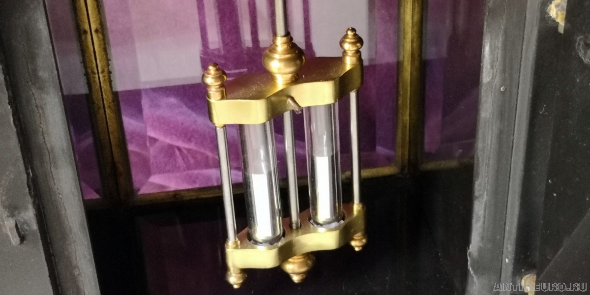

# Как механические часы объявили войну хаосу

Человечество веками укрощает время с помощью колес, пружин и гравитации. Но за завораживающей эстетикой тикающего механизма, где в идеальной гармонии вращаются шестерни, скрывается суровая физическая драма - непрекращающаяся борьба инженерной мысли с хаосом внешнего мира. Чтобы любимый аксессуар на запястье не врал, инженерам приходится решать сложнейшие задачи термодинамики, кинематики и сопротивления материалов. Эволюция часового мастерства - это захватывающая история о том, как менялись масштаб и устройство часовых механизмов, пока законы физики ограничивали рамки возможных решений.

## Башенные гиганты

История механических часов начинается в Европе конца XIII века. Первые механические механизмы были чудовищно громоздкими: их устанавливали на городских башнях, а вес отдельных колёс достигал сотен килограммов. Регулятора хода в современном понимании у них не было вовсе - ритм задавал примитивный шпиндельный спуск с фоллиотом (горизонтальное коромысло с двумя подвижными грузиками), который просто тормозил падающую под действием груза систему зубчатых колёс.

TODO (ФОТО)

Конструкция таких часов не рассчитывалась в современном понимании этого термина. Это была эпоха интуитивных знаний, эстетических догм и грубой эмпирики.

Вместо математических уравнений мастера использовали циркуль, линейку и знания о простых числовых пропорциях (1:2, 1:3, 2:3), которые считались гармоничными и часто заимствовались из архитектуры или музыки. Диаметр колес и количество зубьев подбирались не через расчет скорости, а через визуальную и геометрическую соразмерность, которая исторически доказала свою работоспособность.

Чертежей в современном понимании не существовало. Конструкция "росла" из металла. Кузнец выковывал заготовку колеса с нужным числом зубьев, а затем часами, а то и днями, вручную подпиливал каждый зуб напильником, добиваясь, чтобы он плавно и без заеданий цеплял палеты (зубья) шпиндельного вала. Точность достигалась не предварительным расчетом, а последующей индивидуальной подгонкой каждой детали друг к другу. Часы были уникальным штучным изделием, и детали от одних часов не подходили к другим.

Фоллиот был гениален именно своей "настраиваемостью" без всякой математики. Мастер не рассчитывал период колебаний. Он действовал чисто механически:

- Если часы спешили, он раздвигал грузики к краям коромысла увеличивая плечо и момент инерции, что физически замедляло колебания.
- Если часы отставали, он сдвигал грузики ближе к центру оси уменьшая момент инерции и заставляя механизм работать быстрее.

Это был чистый эмпирический тюнинг: "сделай так, чтобы работало, и запомни, как ты это сделал".

TODO (ФОТО)

Точность таких часов была, мягко говоря, условной: лучшие их них могли ошибаться на 15-30 минут в сутки, а иногда и на целый час. Именно поэтому на циферблатах первых башенных механизмов присутствовала только часовая стрелка (а часто и вовсе только механизм боя колокола). Отслеживать минуты не имело никакого смысла, когда сам прибор "плыл" на полчаса за день. Минутная стрелка стала стандартом лишь во второй половине XVII века, после изобретения маятниковых часов, когда точность механизмов наконец-то позволила надежно делить время на более мелкие и значимые отрезки.

## Революция точности

В 1657 году, революцию в точности хода совершил голландский учёный Христиан Гюйгенс представив миру свою конструкцию часов.

Фундаментом этой революции стало свойство, впервые описанное Галилео Галилеем в конце XVI века, - изохронность маятника. Суть этого явления гениальна и на первый взгляд парадоксальна: период колебаний маятника практически не зависит от амплитуды (размаха) качания, при условии, что углы отклонения остаются относительно малыми (в пределах нескольких градусов). Слово *"практически"* является здесь очень важным и ниже объясняется почему.

Практическая польза этого открытия для часового дела была колоссальной. Если владелец или часовщик при запуске механизма слегка сильнее толкал маятник рукой, тот начинал качаться с большим размахом. Казалось бы, грузу нужно преодолеть больший путь, и время цикла должно увеличиться. Однако из-за большего начального отклонения маятник поднимается выше и, согласно законам сохранения энергии, развивает пропорционально большую скорость в нижней точке траектории. Эти два эффекта физически компенсируют друг друга.

В результате период колебаний оставался практически неизменным, независимо от того, насколько точно раскачали маятник. Это означало, что часы больше не требовали ювелирной точности при запуске маятника после каждого завода, "прощая" мелкие человеческие ошибки. Также при случайном внешнем воздействии сама физика брала на себя поддержание нужного ритма маятника.

Гюйгенс адаптировал маятник в качестве регулятора хода, соединив его с традиционным колёсным механизмом. Но главным его триумфом стало не просто механическое соединение, а гениальное дополнение: циклоидальные щёчки. Эти изогнутые металлические пластины заставляли гибкую нить подвеса маятника огибать их, принуждая груз двигаться по идеальной циклоиде - единственной траектории, которая обеспечивает абсолютную независимость периода колебаний от их размаха.

TODO (ФОТО) Гюйгенс, схема часов

Чтобы понять гениальность решения Гюйгенса, нужно осознать проблему, с которой он столкнулся. Обычный маятник качается по дуге окружности. Галилео Галилей, первым изучивший колебания, эмпирически обнаружил, что при малых углах отклонения период колебаний практически не меняется. Он принял это за абсолютный закон природы, на котором и строил свои проекты часов.

Но Гюйгенс, по сути, опроверг универсальность этого закона. Он строго доказал, что для дуги окружности изохронность - это лишь **практическая иллюзия**, работающая как грубое приближение только для малых углов. Математически он вывел, что при любом конечном увеличении амплитуды период колебаний неизбежно растет. Для часов, претендующих на высочайшую точность, такая "плавающая" погрешность была неприемлема.

Гюйгенс задался вопросом: существует ли кривая, по которой тело скатывалось бы в нижнюю точку за строго одно и то же время, независимо от начальной высоты? То есть тело - это маятник, который скатывается вниз, описывая при этом кривую линию.  Математический гений нашел ответ: это циклоида - кривая, которую описывает точка на ободе колеса, катящегося по прямой.

В своей фундаментальной книге "Маятниковые часы" (Horologium Oscillatorium, 1673) он сформулировал это как знаменитую теорему о таутохроне: *"Если некоторое тело скользит по обращенной вогнутостью вверх циклоиде с вертикальной осью, то оно достигает низшей точки за одно и то же время независимо от того, из какой точки оно начинает движение..."*

Но как заставить маятник двигаться по циклоиде, а не по окружности? Гюйгенс нашёл элегантное механическое решение. По обе стороны от точки подвеса маятника он разместил две изогнутые металлические пластины - циклоидальные щёчки. Когда маятник отклонялся от вертикали, его гибкая нить подвеса начинала огибать эти щёчки. Это динамически изменяло эффективную длину подвеса: чем сильнее отклонение, тем короче становилась нить. Математически это приводило к тому, что груз маятника начинал двигаться не по дуге окружности, а строго по циклоидальной траектории. Результат был ошеломляющим: маятник становился абсолютно изохронным при любых амплитудах. Часы больше не теряли точность из-за того, что маятник качался с разным размахом. Это была первая в истории победа строгой математической теории над физическим хаосом.

TODO (ФОТО) Гюйгенс, циклоидальные щёчки

Результат работы Гюйгенса был ошеломляющим: погрешность лучших часов сократилась с 15 минут до 15 секунд в сутки. Впервые в истории человечество получило инструмент, способный надёжно отсчитывать секунды.

Забавно, а может и закономерно, но если бы Уильям Клемент или Роберт Гук опередили Гюйгенса и изобрели анкерный спуск хотя бы на 20 лет раньше, научный мир мог бы лишиться целого пласта важнейших открытий. В истории часто бывает так, что несовершенство технологий является главным двигателем фундаментальной науки.

Гюйгенс вывел свою знаменитую формулу именно потому, что пытался понять, почему его часы со шпиндельным спуском,  который требовал для работы амплитуду маятника в 40-50 градусов, безбожно врут при её изменении.

Если бы у него изначально был анкерный спуск с его микроскопической амплитудой (2-4 градуса), часы и так шли бы идеально точно. У Гюйгенса просто не возникло бы практической проблемы, требующей глубокого математического анализа. Маятник казался бы часовым мастерам безупречным по умолчанию.

Позже шпиндельный спуск, был полностью вытеснен анкерным спуском. Циклоидные щёчки стали не нужны и полностью исчезли из конструкции часов. Вытеснение шпиндельного спуска анкерным происходило постепенно и заняло около столетия: в интерьерных (настенных и напольных) часах "анкер" окончательно победил в первой половине XVIII века, а в карманных часах шпиндельный спуск продержался в массовом производстве вплоть до 1820-1830-х годов.

Различия между анкерным и шпиндельным спусками, и другими видами спусков, можно узнать по ссылке: [спусковой механизм часов](https://en.wikipedia.org/wiki/Escapement).

## Невидимое дыхание температуры

Казалось, время наконец-то поймано. Но физика готовила часовщикам новые сюрпризы.

Первые же владельцы интерьерных гигантов столкнулись с капризами погоды. В холодные зимние ночи, когда печь в доме остывала, часы начинали заметно спешить, а знойным летом - безнадежно отставать.

Физическая суть этой проблемы крылась в знаменитой формуле самого Гюйгенса: период колебаний маятника строго привязан к его длине, а точнее расстоянию от точки подвеса до центра масс маятника.

TODO формула с пояснениями

Из школьного курса физики мы помним, что металлы расширяются при нагревании. Стержень маятника удлинялся, его центр тяжести опускался, взмахи становились более затяжными, и часы теряли драгоценные минуты.

Чтобы победить тепловое расширение, часовщикам потребовалось найти изящный способ удерживать центр масс на неизменном расстоянии. Гениальное решение предложил Джордж Грэхем, создав ртутный маятник. Он заменил тяжелую железную деталь на конце стержня резервуаром с жидкой ртутью. При повышении температуры стальной стержень удлинялся вниз, но ртуть в банке расширялась вверх. Коэффициенты были рассчитаны так, что эти два процесса идеально компенсировали друг друга.

Для ещё более ювелирной настройки мастера придумали полочку на середине стержня. Кладя на неё микроскопические грузики - обычные монетки, - часовщик мог слегка приподнять центр масс системы вверх, укорачивая эффективную длину маятника. Это позволяло настраивать ход с точностью до сотых долей секунды прямо "на ходу", не останавливая механизм. Стоимость такого улучшения, в отличие от ртутного маятника, была ничтожна.

TODO (ФОТО)

## Путь к минитюриизации

Параллельно с точностью инженеры работали над уменьшением габаритов часового механизма. К XV-XVI векам изобретение заводной пружины позволило уменьшить часы до настольных и даже карманных приборов. Казалось, время стало портативным, и проблема громоздкости решена. Но для мореплавателей эпохи Великих географических открытий эта иллюзия прогресса обернулась новой катастрофой.

Дело в том, что миниатюризация не улучшила точность. В этих компактных часах по-прежнему использовался тот же примитивный шпиндельный спуск с балансиром, что и в башенных гигантах. На суше он давал погрешность в 15-30 минут в сутки, а в условиях морской сырости, перепадов температур и постоянной качки такие механизмы врали еще сильнее их "земельных" аналогов.

TODO (ФОТО)

В навигации цена такой погрешности часто была фатальной. Для определения долготы в открытом океане навигатору для расчёта своего положения необходимо было знать точное время в порту отправления. Поскольку Земля совершает полный оборот на 360 градусов за 24 часа, каждая минута временной ошибки часов переводится в ошибку определения долготы ровно в 15 угловых минут (0.25 градуса). На экваторе это расстояние составляет около 28 километров, а в умеренных широтах - меньше, но всё равно десятки километров.

Проблема была не в том, что корабль сбивался с курса, а в том, что навигатор, доверяя неточным часам, наносил на карту точку, находящуюся в десятках километров от реального положения судна. Он мог быть уверен, что вокруг открытое море, тогда как на самом деле корабль уже приближался к берегу.

Классическим и самым трагическим примером стала катастрофа британского флота адмирала Клаудсли Шовелла в 1707 году у островов Силли. Из-за невозможности точно определить долготу в условиях длительной облачности, эскадра, считавшая, что находится в безопасных водах Атлантики, налетела на рифы. Погибло четыре корабля и около двух тысяч человек.

TODO (ФОТО) адмирал Клаудсли Шовелл, катастрофа

Эта катастрофа стала не единичным случаем, а самой громкой из череды трагедий, подрывавших экономику Англии, а после 1707 года - и объединённой Великобритании, на протяжении десятилетий. К 1714 году потери от навигационных ошибок стали для этой морской державы неприемлемыми. Осознав, что проблема долготы - это вопрос национальной безопасности, и проконсультировавшись с ведущими учёными эпохи (включая Исаака Ньютона и Эдмунда Галлея), парламент Великобритании учредил знаменитый "Акт о долготе" (Longitude Act).

TODO (ФОТО) "Акт о долготе"

Ведущие учёные того времени склонялись к общему мнению, что астрономические методы сложны, полностью зависят от погоды, и практическое решение, скорее всего, лежит в области создания сверхточных часов. Человечеству отчаянно нужен был прибор, способный сохранять ритм вопреки хаосу качки, перепадам температур и влажности, и делить сутки на по-настоящему равные отрезки.

Акт обещал колоссальную денежную премию за создание практического метода определения координат в море, что в итоге и стимулировало создание первого морского хронометра Джоном Гаррисоном. Однако перенести принцип маятника, или просто использовать часы Гюйгенса, на качающейся палубе оказалось невероятно сложной задачей. Маятник в таких условиях работать не мог - его, в теории, мог заменить "баланс": круглое колёсико, колеблющееся на тонкой оси под воздействием закрученной спиральной пружины (волоска). Кстати, сам волосок изобрёл всё тот же Гюйгенс в 1675 году. Но конструкция баланса с волоском оказалась слишком чувствительна к перепадам температур и резким движениям, что делало его бесполезным в море. Осознав это, гениальный английский часовщик Джон Гаррисон пошёл нестандартным путем. В своем первом морском хронометре (H1, 1735 год) он намеренно отказался от спиральной пружины баланса. Вместо этого Гаррисон создал систему из двух связанных коромысел-балансов, колеблющихся в строгой противофазе. Когда корабль кренился, инерция одного баланса физически компенсировала инерцию другого, нейтрализуя влияние качки. Это был, по сути, "маятник, который не боится движения". И лишь много лет спустя, в своем финальном шедевре (H4, 1759 год), Гаррисон вернулся к классической паре "баланс-волосок", но снабдил ее революционной биметаллической компенсацией температуры, окончательно заставив время подчиняться законам навигации.

TODO (ФОТО) первого морского хронометра Джоном Гаррисоном

## Чем меньше, тем сложнее

На пути миниатюризации, часы покинули спокойные отапливаемые гостиные и переместились на корабли. Далее они нашли своё место в карманах и на запястьях людей. Здесь конструкторы столкнулись со следующим препятствием - чувствительностью к внешним воздействиям. Тяжёлый интерьерный маятник обладал достаточной массой, чтобы его инерция легко преодолевала сопротивление воздуха или лёгкую вибрацию стен. Наручные же часы были зажаты в жёсткие рамки: их колесо-баланс весит доли грамма и крайне чувствителен к любым внешним воздействиям. Попытка сделать колесо-баланс тяжелее приводила к катастрофе - при первом же падении кинетическая энергия массивного маховика просто ломала тончайшие цапфы (оси) механизма, которые по толщине сопоставимы с человеческим волосом. В итоге задача сводилась к тому, что баланс должен оставаться лёгким, но при этом сопротивляться внешним воздействиям. Не имея достаточной массы, баланс становился уязвимым перед вибрацией, особенно в крайних "мёртвых" точках, где его скорость на мгновение падает до нуля перед сменой направления движения. Инженерное решение проблемы заключалось в том, чтобы перенести акцент в конструкции баланса с массы на скорость.

TODO (ФОТО) формула с пояснениями

Поскольку энергия системы растёт пропорционально квадрату скорости, радикальное увеличение частоты колебаний баланса позволяло даже сверхлёгкой детали накапливать большой динамический импульс. Этот эффект хорошо знаком каждому, кто запускал детскую юлу: быстро вращающийся диск приобретает жёсткий "динамический упор", и случайному внешнему сотрясению становится крайне сложно изменить ось его вращения. Физическая природа явления едина: накопленная кинетическая энергия, будь то вращение или колебание, создаёт инерционную устойчивость, которая противостоит внешним возмущениям.

Большая скорость вращения баланса требовала уменьшить трение осей об опору, что вело к их утончению. Чтобы защитить нежные оси от неминуемой поломки при падении, часовщикам потребовалась революционная идея. Еще в 1790 году великий Абраам-Луи Бреге первым в истории запатентовал систему противоударной защиты, поэтично назвав её "парашют" (pare-chute). Однако его решение было сложным и дорогим, оставаясь уделом элитных карманных часов.

TODO (ФОТО) система амортизации pare-chute

Настоящий прорыв для массовых наручных часов произошел лишь в 1934 году, когда была разработана знаменитая система Incabloc. Инженеры установили рубиновые камни-подшипники в подвижные оправы, удерживаемые тонкой пружинкой в форме лиры. При ударе ось слегка смещается, передавая основную энергию толчка на массивный корпус часов, а затем пружинка-трамплин мгновенно возвращает её в идеальный центр. Это сделало механические часы по-настоящему устойчивыми к реалиям повседневной жизни.

TODO (ФОТО) система амортизации Incabloc

Казалось бы, высокая частота и система амортизации делают часы точными и надёжными. Но едва часовщики решили проблему резких ударов, как перед ними выросла новая, парадоксальная преграда - обычная человеческая ходьба. Чтобы понять, почему ходьба стала проблемой для точности хода, нужно заглянуть в физику работы баланса.

В 1827 году английский математик и астроном Джордж Эри (G. Airy) сформулировал положение, получившее впоследствии название "теоремы Эри", которое играет основополагающую роль в теории часовых механизмов. Она гласит: "Импульс, направленный к положению равновесия, уменьшает ход часов; импульс, направленный от положения равновесия, увеличивает ход часов, а действующий в положении равновесия - не изменяет ход часов". Давайте разберёмся с этими утверждениями детально и заглянем глубже в физику процессов.

Сперва нужно разобраться с формулировками теоремы:

- "Импульс, направленный к положению равновесия, уменьшает ход часов" (часы отстают). Если внешняя сила подталкивает баланс в направлении его движения к центру, она добавляет системе энергию. Амплитуда колебаний увеличивается. Из-за нелинейности механизма больший размах приводит к увеличению периода колебаний. Часы начинают отсчитывать "длинные" секунды и отстают.

- "Импульс, направленный от положения равновесия, увеличивает ход часов" (часы спешат). Если внешняя сила действует против движения баланса, она отбирает энергию у системы. Амплитуда уменьшается, и из-за нелинейности период колебаний сокращается. Часы начинают отсчитывать "короткие" секунды и спешат.

- "Импульс, действующий в положении равновесия, не изменяет ход часов". Это утверждение является приближением к истине. В идеальной линейной системе изменение скорости в точке равновесия меняет амплитуду, но не влияет на период. В реальной нелинейной системе часового баланса воздействие в этой фазе всё равно вызывает микроскопические изменения, но по сравнению с двумя другими случаями они минимальны, и теорема Эри справедливо считает их пренебрежимо малыми.

Рассмотрим эти процессы ещё глубже. Балансовый узел - это классический гармонический осциллятор. В момент прохождения центра (точки равновесия) угловая скорость баланса максимальна, а возвращающий момент и угловое ускорение равны нулю. Таким образом, в этой точке кинетическая энергия и угловой момент баланса максимальны, а потенциальная энергия спирали равна нулю. Из-за высокой инерции движения любое случайное внешнее воздействие вызывает лишь ничтожно малое относительное изменение скорости. Иными словами, в этой фазе внешней силе "не с чем" резонировать: у баланса нет накопленного потенциала пружины, который внешняя сила могла бы усилить или подавить. Понятно, что в этой точке баланс наименее уязвим к внешним воздействиям.

Но всё меняется в крайних положениях, так называемых "мёртвых точках". В этот миг угловая скорость падает строго до нуля, а спираль волоска скручена максимально. Согласно законам механики, именно здесь возвращающий момент и угловое ускорение достигают своего абсолютного пика. Именно это делает баланс максимально уязвимым. Дело в том, что в мёртвой точке кинетическая энергия системы равна нулю. У баланса нет инерционного "иммунитета", чтобы противостоять внешнему вектору силы.В этой критической фазе дальнейшая эволюция системы определяется исключительно знаком и величиной возвращающего момента волоска. Система находится в состоянии максимальной чувствительности к возмущениям - подобно критической точке в нелинейной динамике, где малое изменение параметра приводит к качественному изменению поведения. В мёртвой точке любое внешнее ускорение от движения руки не просто сдвигает фазу колебания баланса вперёд или назад, оно сообщает системе дополнительную энергию, изменяя амплитуду колебаний.

И здесь мы сталкиваемся с той же проблемой, что и Гюйгенс полтора века назад. Как мы уже видели, зависимость периода колебаний от амплитуды - это не исключение, а общее свойство механических осцилляторов. Для маятника Гюйгенс решил эту проблему через циклоиду. Но в балансе эта проблема проявляется острее, потому что механизм баланса обладает собственными, специфическими нелинейностями, которых не было у простого маятника:

- Эффект "дыхания" спирали. При раскручивании и скручивании плоская спираль не сжимается идеально равномерно. Её центр тяжести совершает микроскопические смещения в сторону, словно спираль "дышит". Это меняет эффективную длину пружины и искажает возвращающий момент, нарушая изохронность. Именно для борьбы с этим Абраам-Луи Бреге изобрёл знаменитую "кривую Бреге" (поднятый внешний виток), которая заставляет спираль сжиматься концентрически, максимально приближая её поведение к идеальному, но не устраняет нелинейность полностью.

- Геометрические нелинейности спускового механизма. Палеты анкерной вилки и импульсный камень баланса имеют сложную асимметричную геометрию с различными углами входа и выхода. Передача энергии происходит дискретно (отдельными порциями), с зазорами и трением скольжения, что создаёт нелинейные возмущения в каждом цикле.

- Нелинейное демпфирование. Трение в цапфах зависит от нагрузки и скорости, создавая эффект "залипания" (stiction) в моменты остановки, что дополнительно искажает идеальную синусоиду колебаний.

Баланс, как и гравитационный маятник, является нелинейным осциллятором. Но если в маятнике нелинейность связана в основном с геометрией траектории, то в балансе источников нелинейности гораздо больше: сама природа спирали, асимметрия работы спускового механизма, трение в цапфах. Их совместное действие делает систему баланса значительно более чувствительной к внешним воздействиям, а её поведение - гораздо более вариативным.

Проблема точности хода усугубляется биомеханикой. При ходьбе или беге рука человека генерирует не хаотичные, а строго периодические циклические ускорения с частотой примерно от 1.5 до 3 Гц (около 90-180 шагов в минуту). Кривая этого ускорения представляет собой низкочастотную волну с довольно широкой и длительной фазой воздействия.

Если частота колебаний баланса кратна или близка к ритму шага (например, баланс на 3 Гц при ходьбе 1.5 Гц, или баланс на 4 Гц при ходьбе 2 Гц), возникает коварное явление нелинейной динамики, известное как фазовая синхронизация (или захват частоты). Регулярное внешнее ускорение от шага не просто хаотично сбивает механизм, а систематически "подстраивается" под цикл баланса, воздействуя на него в одни и те же уязвимые фазы разворота. Представьте это как ритмичные, едва заметные подталкивания качелей: по отдельности каждый импульс микроскопичен, но, совпадая по фазе, они начинают "перетягивать" ритм механизма на себя. За 86 400 секунд в сутки эти микроскопические искажения накапливаются, заставляя часы стабильно спешить или отставать в зависимости от индивидуальной биомеханики походки владельца. Часы буквально "подстраиваются" под ритм человека.

Единственным решением этой проблемы стало радикальное увеличение частоты колебаний баланса (до 4, 5 и даже 10 Гц). Это дает двойной физический выигрыш:

- Жёсткость системы. Для высокой частоты работы баланса требуется более жёсткий волосок. Он создает гораздо более мощный возвращающий момент, делая колебательную систему "нечувствительной" к относительно слабым низкочастотным возмущениям от руки.

- Сужение окна уязвимости. Высокочастотный баланс пролетает свои "мёртвые точки" с гораздо большей угловой скоростью. Время, которое он проводит в уязвимой фазе разворота, уменьшается с ростом частоты колебаний, а низкочастотная волна человеческого шага просто "усредняется" и нивелируется на фоне десятков тысяч тактов в час.

## Где заканчивается физика и начинается экономика

Именно свойство баланса с увеличением частоты стабилизировать средний период колебаний привело к современному разделению часовых механизмов на технологические классы по признаку частоты колебаний баланса. Но здесь важно сделать оговорку, которая часто теряется за обсуждениями "превосходства" одних механизмов над другими: это деление обусловлено не столько физикой, сколько экономикой.

Природа не предусмотрела никаких "правильных" частот в 2.5, 4 или 5 Гц. Осциллятор может быть настроен на любую величину в довольно широком диапазоне. Инженер способен заставить баланс колебаться и с 3.5, и с 6 Гц. Вопрос в другом: сколько будет стоить такой механизм, и кто согласится платить за результат?

Цепочка зависимостей здесь жёсткая. Повышение частоты означает, что за ту же секунду анкерная вилка и импульсный камень сталкиваются чаще. Каждый контакт - это трение, износ и потеря энергии. Масляная плёнка в подшипниках успевает восстанавливаться хуже, нагрузки на цапфы растут, а требования к чистоте обработки поверхностей становятся почти запредельными. В итоге конструктор вынужден переходить на специальные синтетические масла, более твёрдые сплавы, точнейшую юстировку и, в конце концов, на кремниевые детали, изготавливаемые методом глубокого реактивного ионного травления. А это уже не просто станок в мастерской, пускай очень точный и дорогой, но - чистое производство с его режимами доступа, системой фильтрации, и дорогими технологическими оснастками.

И платит владелец часов не только при их покупке. Высокочастотный механизм - это ещё и более дорогой сервис. Усиленное трение сокращает межсервисные интервалы, повышает требования к качеству смазки и требует более квалифицированного обслуживания. Через несколько лет владения стоимость обслуживания может оказаться сопоставимой со стоимостью самих часов.

Поэтому рынок естественным образом выстроил несколько точек равновесия - не оптимумов, а именно устойчивых компромиссов:

- Низкая частота - это не всегда "дешёво и плохо". 2.5-3 Гц означают меньше циклов трения в час, бережный расход смазки, больший запас хода и простоту обслуживания. Именно поэтому такие частоты применяются не только в доступных "рабочих лошадках", но и в механизмах высокой сложности (так называемых усложнениях, или complications). Например, для турбийона (Tourbillon) или минутного репетира (Minute Repeater) гораздо безопаснее работать с умеренными скоростями и нагрузками на колёсную систему, что продлевает жизнь их хрупким и дорогостоящим деталям..

TODO (ФОТО) циферблат с делением секунды на отрезки

- 4 Гц - главный промышленный компромисс последних десятилетий. Это та редкая точка, где достаточная устойчивость к внешним воздействиям встретилась с приемлемым износом, стандартной номенклатурой запчастей и обширным сообществом мастеров, умеющих качественно обслуживать такие механизмы. Массовость подобных механизмов закрепила эту частоту не велением законов физики, а силой производственной кооперации.

TODO (ФОТО) циферблат с делением секунды на отрезки

- 5 Гц и выше - премиальная надбавка за инженерный интеллект. Здесь потребитель платит за передовые технические разработки, особые материалы и ограниченную серию. Какую то часть этой стоимости покупатель возвращает себе в виде повышенной динамической стабильности хода часов, но основная стоимость уплачена за право владеть редким вополщением передовых технических идей.

TODO (ФОТО) циферблат с делением секунды на отрезки

- 8-10 Гц - уже не про массовый рынок, а про технологический флагман. На этой скорости обычная стальная пара трения перестаёт быть надёжной, и в игру вступает кремний. Себестоимость такого механизма резко идёт вверх, а выигрыш в суточном ходу становится всё менее заметным. Это вложение в свой имидж, а не в точность хода часов. И здесь кроется самый важный нюанс, который стоит запомнить: частота - не то же самое, что точность. Короткий такт лишь уменьшает чувствительность к отдельным толчкам и улучшает стабильность хода. Но реальное отклонение в точности за сутки определяется качеством сборки, регулировкой механизма в разных пространственных положениях, температурной стабилизацией и защитой от магнитных полей. Отлично отрегулированный механизм на 21 600 полуколебаний в час (3 Гц) легко обойдёт плохо собранный "высокочастотник".

TODO (ФОТО) циферблат с делением секунды на отрезки

Именно так рынок и пришёл к существующему делению на "частотные классы" - не по принципу "чем больше Герц, тем лучше", а по принципу "какая цена за какую степень инженерного мастерства".

## Заключение

Механические часы прошли удивительный эволюционный путь. Они трансформировались из тяжёлых метровых маятников, боровшихся с невидимым расширением металла, в микроскопические композитные устройства, вибрирующие на вашем запястье с частотой до 10 Гц ради равномерного отсчёта временных отрезков.

И каждый раз, прислушиваясь к тихому тиканью часов, мы слышим не просто работу механизмов. Мы слышим торжество человеческой мысли над хаосом физического мира, запертое в корпусе из стали и сапфирового стекла.